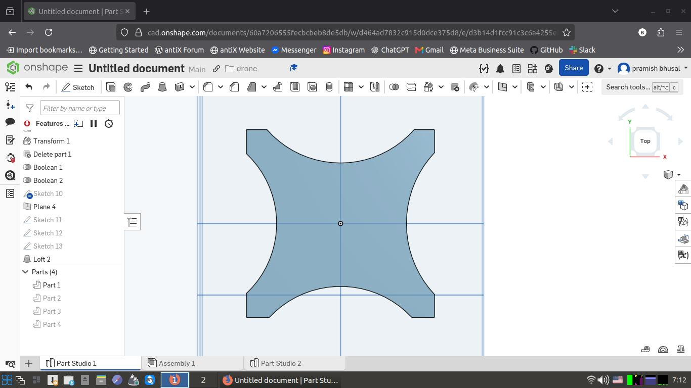
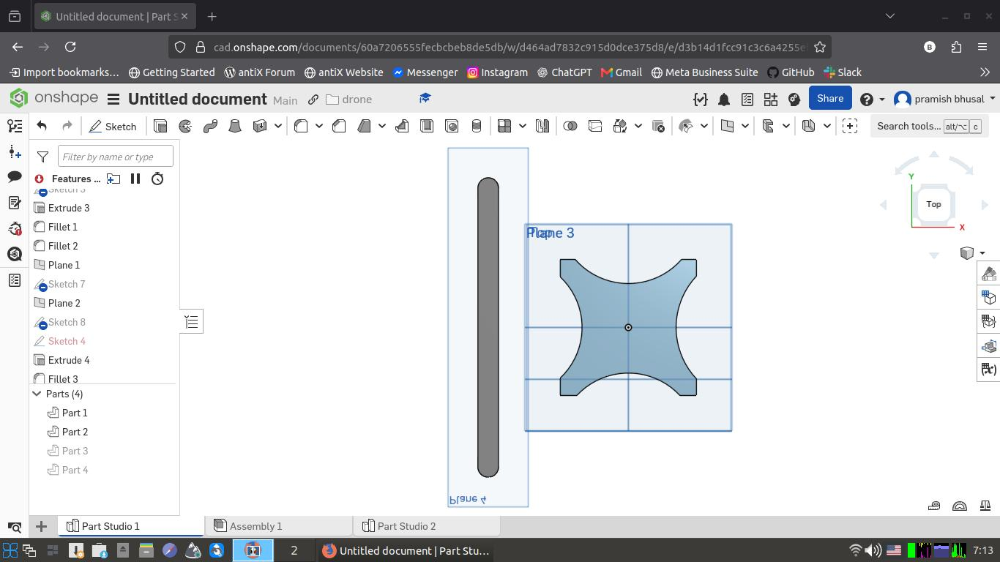
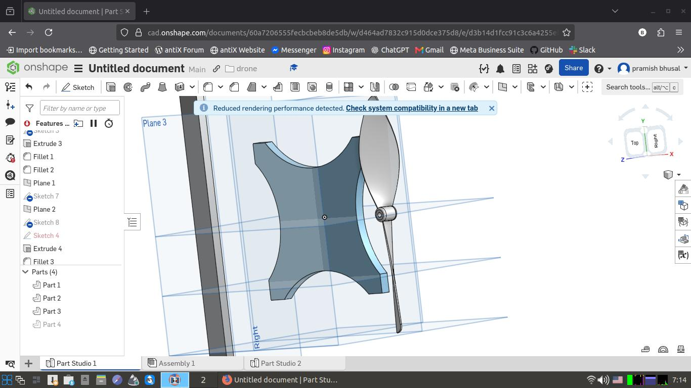
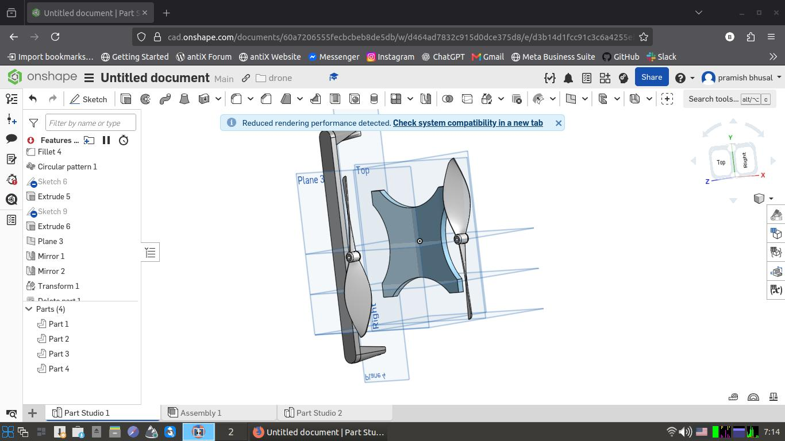
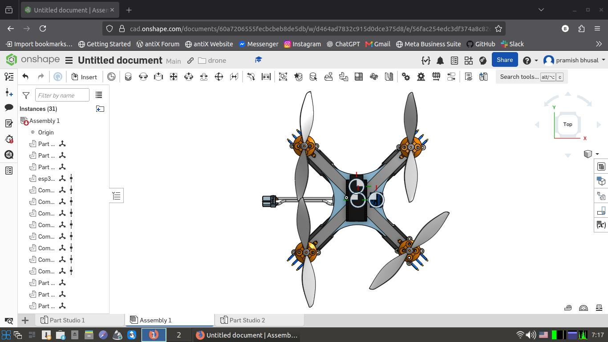
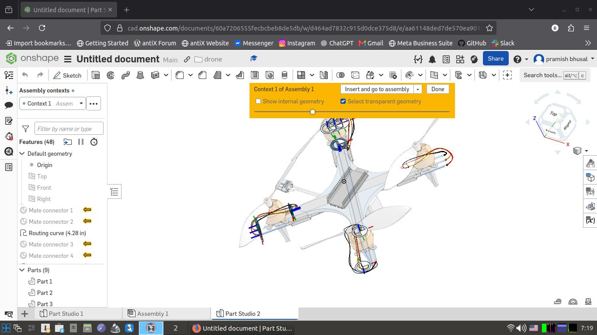
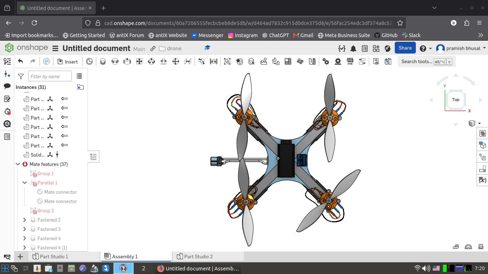

# JOURNAL

| TITLE | data |
|---------|-------|
|Author | [Pramish Bhusal](https://www.pramishbhusal.com.np/) |
| Slack ID | U0BFGKERFBR (bpramish71)|
| Created | 1 aug 2026 |
|Last Updated | 13 nov 2026 |
| Total Time | 15 Hours |
| Project Type| cad |

## 1-4 aug 5:00pm~7:00pm 

It's time for my first hackclub project after joining and learning pretty much stuff about hc. I decided to make a drone cad model which i had half done before so it's time to to rebuild it again by my own. First some days and hours were spent in onshape - learing it and building it. I had to do some maths tooo to make the design plan. In this period I just made part design only by learing it.

## 7 aug 4:00pm~5:00pm

Working in exam - it was holiday tomorrow. I couldn't do much stuffs due to exam but I worked for around 1hr so i just made assembly - I don't have exject idea what i build that time but as i know i was struggling with assembly - the image below isn't the whole thing i had done then but i had just assembled the chasis and esp ig. 

This image is even after that day but remove the drone, mpu, propeller, battery then it's exjectly what i did that day - i don't have img for that day.

## 14-16 aug 5:00pm~7:00pm

Exams are finally over and project(cad) is half done I had some assembly and wire stuff remaining which took around 3.5 hrs. These advance stuffs were pretty tuff too but some how i made this project - I made propeller, wire, assembled motors and mpu in assembly. 

## Afterward

Well all other tracks are in hackatime and github commit history - i immideatly jumped to docs and codes which didn't took a lot compared to cad model but it took ~5-6hr. I don't think i need any screenshoot of the code
