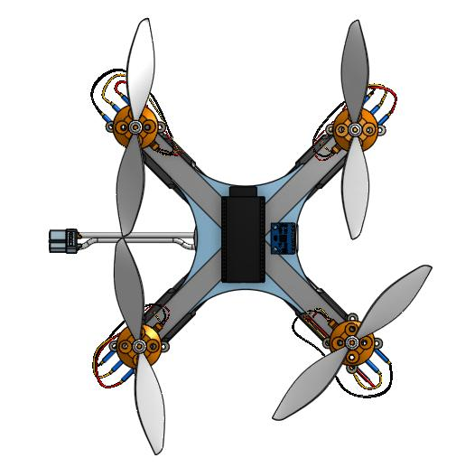

# Quad Coptor
Quadcoptor is a flying device with 4 propeller in each edge. The 4 wings creates the up thrust to lift the drone and there rotation creates rotation thrust to rotate the drone. 

This is a simple quadcoptor project(model) where the quadcoptor can fly and be controlled with mobile.

This is the final look of the drone in 3d design through onshape you can view it through this [link](https://cad.onshape.com/documents/60a7206555fecbcbeb8de5db/w/d464ad7832c915d0dce375d8/e/56fac254edc3df374a8c82de?renderMode=0&uiState=6af7168fdd7eea51f23f351d)

## Material used

The materials used in this project are given in the table

| Material name | rate(NPR) | quantity | total cost(NPR) | link |
|---------------|------|----------|------------|------|
| A2212/13T BLDC Motor | 900 | 4 | 3600 | [link](https://www.daraz.com.np/products/a221213t-1000-kv-brushless-motor-i125550186-s1037883793.html?c=&channelLpJumpArgs=&clickTrackInfo=query%253A1000kv%252Bbldc%252Bmotor%253Bnid%253A125550186%253Bsrc%253ALazadaMainSrp%253Brn%253A175152e53664f9e6c8dae19b0fa189c9%253Bregion%253Anp%253Bsku%253A125550186_NP%253Bprice%253A900%253Bclient%253Adesktop%253Bsupplier_id%253A900156978057%253Bsession_id%253A%253Bbiz_source%253Ah5_external%253Bslot%253A5%253Butlog_bucket_id%253A470687%253Basc_category_id%253A9353%253Bitem_id%253A125550186%253Bsku_id%253A1037883793%253Bshop_id%253A87928%253BtemplateInfo%253A&freeshipping=0&fs_ab=1&fuse_fs=&lang=en&location=Bagmati%20Province&price=9E%202&priceCompare=skuId%3A1037883793%3Bsource%3Alazada-search-voucher%3Bsn%3A175152e53664f9e6c8dae19b0fa189c9%3BoriginPrice%3A90000%3BdisplayPrice%3A90000%3BisGray%3Afalse%3BsinglePromotionId%3A-1%3BsingleToolCode%3A-1%3BvoucherPricePlugin%3A0%3Btimestamp%3A1786972008329&ratingscore=4.619047619047619&request_id=175152e53664f9e6c8dae19b0fa189c9&review=21&sale=119&search=1&source=search&spm=a2a0e.searchlist.list.5&stock=1) |
| 10 in propeller | 199 | 4 | 796 | [link](https://www.daraz.com.np/products/1045-propeller-blade-10x45-clockwise-and-counter-clockwise-i131822672-s1039065056.html?c=&channelLpJumpArgs=&clickTrackInfo=query%253A1045%252Bpropeller%253Bnid%253A131822672%253Bsrc%253ALazadaMainSrp%253Brn%253Afb92cca39b05d893369f4cd3b58c3fbb%253Bregion%253Anp%253Bsku%253A131822672_NP%253Bprice%253A199%253Bclient%253Adesktop%253Bsupplier_id%253A900152196021%253Bsession_id%253A%253Bbiz_source%253Ah5_external%253Bslot%253A0%253Butlog_bucket_id%253A470687%253Basc_category_id%253A10002948%253Bitem_id%253A131822672%253Bsku_id%253A1039065056%253Bshop_id%253A40237%253BtemplateInfo%253A-1_A3_C%2523&freeshipping=0&fs_ab=1&fuse_fs=&lang=en&location=Gandaki%20Province&price=199&priceCompare=skuId%3A1039065056%3Bsource%3Alazada-search-voucher%3Bsn%3Afb92cca39b05d893369f4cd3b58c3fbb%3BoriginPrice%3A19900%3BdisplayPrice%3A19900%3BisGray%3Afalse%3BsinglePromotionId%3A-1%3BsingleToolCode%3A-1%3BvoucherPricePlugin%3A0%3Btimestamp%3A1786972760665&ratingscore=&request_id=fb92cca39b05d893369f4cd3b58c3fbb&review=&sale=0&search=1&source=search&spm=a2a0e.searchlist.list.0&stock=0) |
| esp 32 | 2000 | 1 | 2000 | [link](https://www.daraz.com.np/products/esp32-development-board-i511363277-s2291645002.html?c=&channelLpJumpArgs=&clickTrackInfo=query%253Aesp32%253Bnid%253A511363277%253Bsrc%253ALazadaMainSrp%253Brn%253A25b141ab8de7e549c3e74e483d6bb534%253Bregion%253Anp%253Bsku%253A511363277_NP%253Bprice%253A1249%253Bclient%253Adesktop%253Bsupplier_id%253A900306672194%253Bsession_id%253A%253Bbiz_source%253Ah5_pdp%253Bslot%253A1%253Butlog_bucket_id%253A470687%253Basc_category_id%253A10002890%253Bitem_id%253A511363277%253Bsku_id%253A2291645002%253Bshop_id%253A221346%253BtemplateInfo%253A&freeshipping=0&fs_ab=1&fuse_fs=&lang=en&location=Bagmati%20Province&price=1249&priceCompare=skuId%3A2291645002%3Bsource%3Alazada-search-voucher%3Bsn%3A25b141ab8de7e549c3e74e483d6bb534%3BoriginPrice%3A124900%3BdisplayPrice%3A124900%3BisGray%3Afalse%3BsinglePromotionId%3A-1%3BsingleToolCode%3AmockedSalePrice%3BvoucherPricePlugin%3A0%3Btimestamp%3A1786972854182&ratingscore=4.6&request_id=25b141ab8de7e549c3e74e483d6bb534&review=5&sale=22&search=1&source=search&spm=a2a0e.searchlist.list.1&stock=1) |
| 30A esc | 1000 | 4 | 4000 | [link](https://www.daraz.com.np/products/30a-brushless-motor-esc-i124370679-s1033771262.html?c=&channelLpJumpArgs=&clickTrackInfo=query%253A30%252Ba%252Besc%253Bnid%253A124370679%253Bsrc%253ALazadaMainSrp%253Brn%253A67277a09ec28711f70ee7dfc165b9e0f%253Bregion%253Anp%253Bsku%253A124370679_NP%253Bprice%253A1000%253Bclient%253Adesktop%253Bsupplier_id%253A900154884202%253Bsession_id%253A%253Bbiz_source%253Ah5_external%253Bslot%253A1%253Butlog_bucket_id%253A470687%253Basc_category_id%253A10000487%253Bitem_id%253A124370679%253Bsku_id%253A1033771262%253Bshop_id%253A71637%253BtemplateInfo%253A&freeshipping=0&fs_ab=1&fuse_fs=&lang=en&location=Bagmati%20Province&price=1E%203&priceCompare=skuId%3A1033771262%3Bsource%3Alazada-search-voucher%3Bsn%3A67277a09ec28711f70ee7dfc165b9e0f%3BoriginPrice%3A100000%3BdisplayPrice%3A100000%3BisGray%3Afalse%3BsinglePromotionId%3A-1%3BsingleToolCode%3A-1%3BvoucherPricePlugin%3A0%3Btimestamp%3A1786973243954&ratingscore=&request_id=67277a09ec28711f70ee7dfc165b9e0f&review=&sale=3&search=1&source=search&spm=a2a0e.searchlist.list.1&stock=1) |
| 3s 12v 50c lipo battery | 5850 | 1 | 5850 | [link](https://www.daraz.com.np/products/lipo-battery-3300-mah-3s-12v-lithium-polymer-battery-i122488099.html) |
| mpu 6050 | 455 | 1 | 455 | [link](https://www.daraz.com.np/products/mpu-6050-module-i125609213-s1035265337.html?c=&channelLpJumpArgs=&clickTrackInfo=query%253Ampu%252B6050%253Bnid%253A125609213%253Bsrc%253ALazadaMainSrp%253Brn%253Aa88149846a74c5adf217f71ec71291a4%253Bregion%253Anp%253Bsku%253A125609213_NP%253Bprice%253A455%253Bclient%253Adesktop%253Bsupplier_id%253A900156978057%253Bsession_id%253A%253Bbiz_source%253Ah5_external%253Bslot%253A0%253Butlog_bucket_id%253A470687%253Basc_category_id%253A10000489%253Bitem_id%253A125609213%253Bsku_id%253A1035265337%253Bshop_id%253A87928%253BtemplateInfo%253A&freeshipping=0&fs_ab=1&fuse_fs=&lang=en&location=Bagmati%20Province&price=455&priceCompare=skuId%3A1035265337%3Bsource%3Alazada-search-voucher%3Bsn%3Aa88149846a74c5adf217f71ec71291a4%3BoriginPrice%3A45500%3BdisplayPrice%3A45500%3BisGray%3Afalse%3BsinglePromotionId%3A-1%3BsingleToolCode%3A-1%3BvoucherPricePlugin%3A0%3Btimestamp%3A1786973730665&ratingscore=4.833333333333333&request_id=a88149846a74c5adf217f71ec71291a4&review=6&sale=41&search=1&source=search&spm=a2a0e.searchlist.list.0&stock=1) |

**Total: Rs.16701**

---

## Circit diagram

### Explaination 

- **Connection:** All the digital(signal) pins are controlled and connected by esp32 while power is circulated from motor esc to esp and mpu6050 through battery.

- **motor rotation:** each pair of diagonal motor has same wiring but one pair has swaped 2 wire compared to another. It cancels rotation thrust of drone.

- **mpu 6050:** This is a 6-axis gyro and accelerometer. This tells the acceleration and change in rotation which helps to manage the stability of drone.

---

## How it works?

- **Signal input:** The drone is connected by bluetooth and contorlled by an app which gives us 8 signals('F', 'B', 'L', 'R', 'Y', 'Z', 'U', 'D') 

- **Calculating error and change required in tororence:** 4 motors are controlled by a esp32 and esc for each. they use some maths and physic to be stabel. The concept used to calculate the speed of motor to make the drone stable is given:

$$
\begin{bmatrix} m1 \\
 m2 \\
 m3 \\
 m4 
\end{bmatrix} = \begin{bmatrix} 1 & -1 & -1 & 1 \\
 1 & 1 & -1 & -1 \\
 1 & -1 & 1 & -1 \\
 1 & 1 & -1 & 1 
\end{bmatrix} 
\left( 
\begin{bmatrix} H_e \\ 
R_e \\ 
P_e \\ 
Y_e 
\end{bmatrix} \begin{bmatrix} K_p^H \\ 
K_p^R \\ 
K_p^P \\ 
K_p^Y 
\end{bmatrix} 
\right)
$$

**Where:**

 - **$mx$** is the required changed to motor torence.
 - **$H$** is the height of dorne
 - **$R$** is the roll of drone.
 - **$P$** is the pitch of drone.
 - **$Y$** is the yaw of drone
 - **$e$** is the error.
 - **$K_p$** is propertional which tells how aggressively should the tororence be changed per unit error.

- **Changing the tororence:** Here we change the tororence of the motor using what we calculated last time.

$$
\begin{bmatrix} T_{m1} \\ 
T_{m2} \\ 
T_{m3} \\ 
T_{m4} 
\end{bmatrix} = \begin{bmatrix} m1 \\ 
m2 \\ 
m3 \\ 
m4 
\end{bmatrix} + \begin{bmatrix} T \\ 
T \\ 
T \\ 
T 
\end{bmatrix} 
$$

**Where:**

 - **$T$** is the base tororance.
 - **$T_mx$** is the tororence to motor *x*.

---

## What I learnt throough this project

This is a simple project which helped me to understand about hardware, microcoroller, aerodynamic, physic and some electricity. I learnt:

- **Aerodynamic and physic:** This project taught me about how rotation speed with a respected direction effects drone motion and rotation. I learnt about thrust

- **Electricity:** One of the unexpected hardest part of this project was managing electricity/current for the component. It taught me about importance of c-rating, capacity of battery while doing poject like this; just normal 12v lipo battery can't provide enough power for all 4 motor to lift and control drone

- **Some component knowledge:** I used a new component called mpu 6050 which helped me to contorl the drone movement. I had also done something new and big with esp32.

---

## Some extra info...

I did most of my research through chatgpt and youtube. I had learnt most of the required concept for this project years ago(roughly) but uniting all and making project like this also required some extra research
